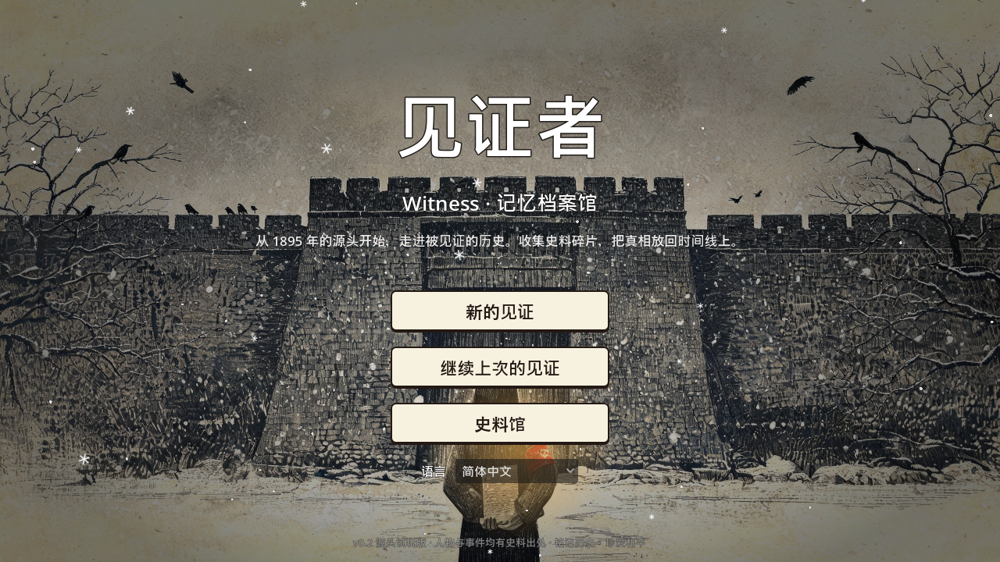
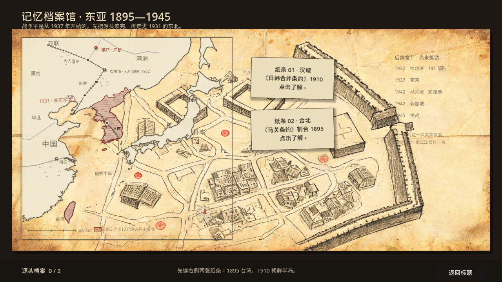
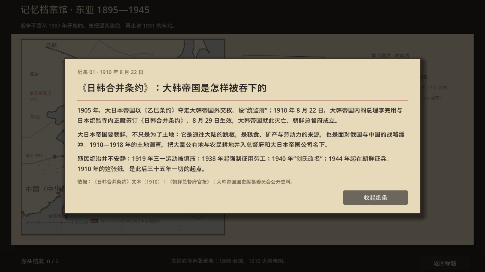
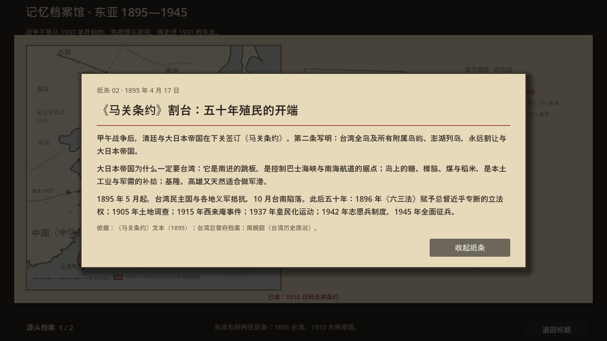
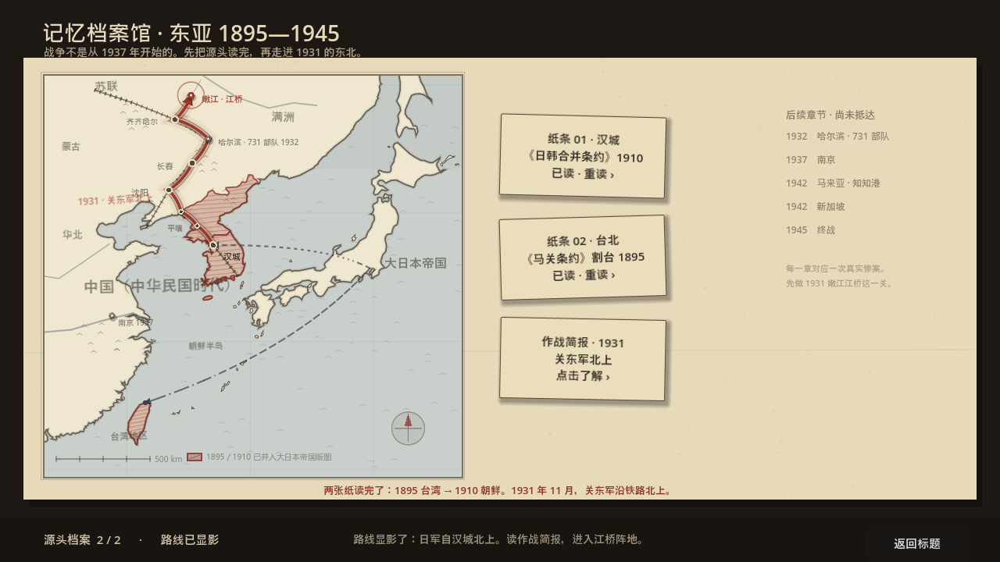
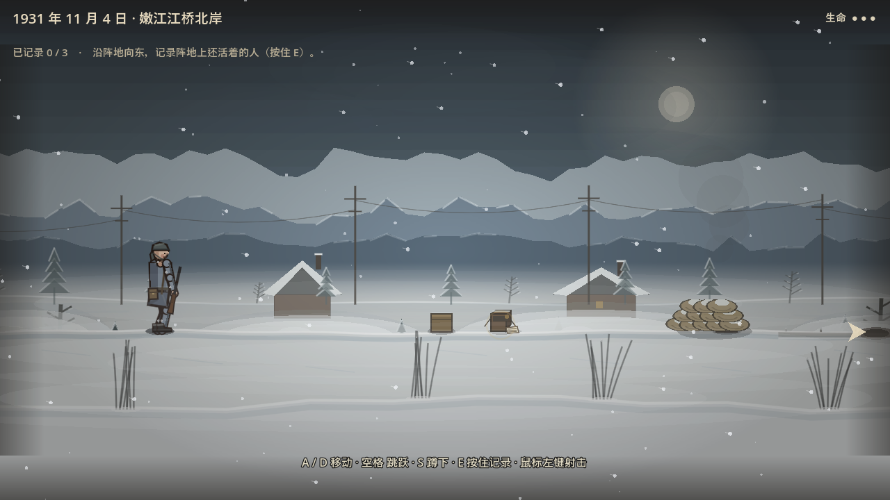
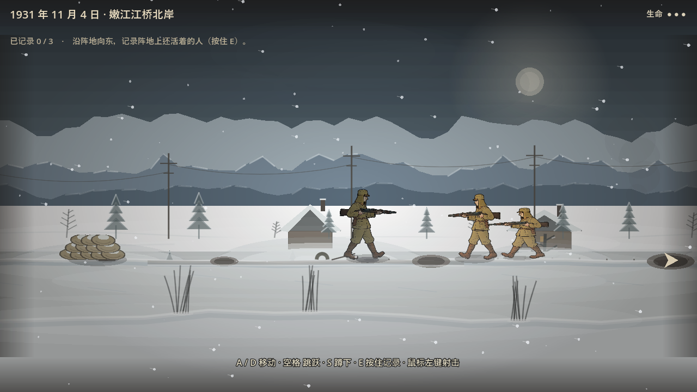
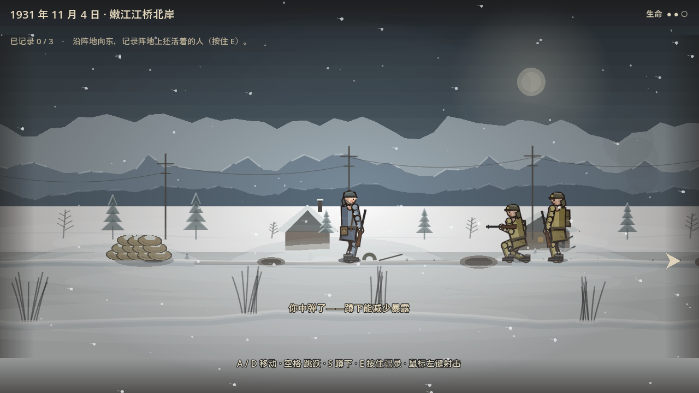
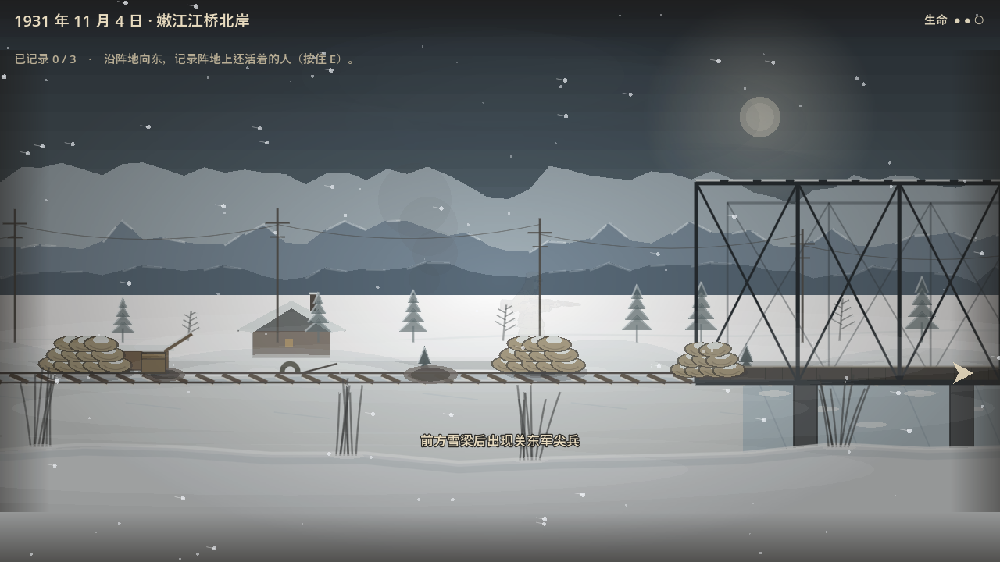

# 见证者（Witness）· v0.6 手绘漫画风试玩版

> 二战的历史不是从 1937 年才开始的。要还原事实，就得从源头讲起——1895 年的马关条约、1910 年的日韩合并条约，殖民如何一步步吞下朝鲜半岛与台湾地区，直到 1931 年九一八、1937 年的南京。

一款 **2D 叙事严肃游戏**（Godot 4.7 .NET + C#）。

## 视觉修复 Changelog（v1.6b → v1.6k · 2026-10-23）

> 以下修复全部实机截图验证（自动化巡游脚本 `scripts/VerifyTour.cs` · 2026-10-23 重新跑完覆盖）。

### ✅ 已修复 · 尸体倒吊 180° 脚朝天（commit `4a54858` v1.6k）

**根因**：CorpseActor 旋转搞了双重节点——Node2D.Rotation=90° 让尸体水平躺，Sprite2D 又 Rotation=90°（v1.6i 加的，想让立绘在 Node2D 旋转前先躺平），两个叠加 = **180° 脚朝天倒吊**！中间多次尝试修 FlipV/FlipH 都没意识到是双重旋转叠加的问题。

**修复**（`scripts/CorpseActor.cs` 三层节点结构）：
```
CorpseActor (Node2D)      → Position=尸体地面位置, Rotation=0（不旋转！）
  └─ _body (Node2D)        → Rotation=90°±15°（负责水平躺倒+轻微歪斜）
      └─ _sp (Sprite2D)   → 原始方向只做 FlipH（头朝哪），不旋转！
```
每层只做一件事，绝对不双重旋转。

**史实姿势**（不变）：
- 70% 向前扑倒（头朝冲锋方向）
- 25% 向后倒下（头朝反方向）
- 5% 侧卧（头朝随机）
- 全部只加 ±15° 轻微歪斜（不是 55-125° 乱倒）

**验证点**：尸体水平躺着，有的头朝左有的头朝右，没有倒吊的。

---

### ✅ 已修复 · HUD 标题被截断（commit `4a54858` v1.6k）

**根因**：HUD 日期标签字号 20px，没有 MinimumSize，完整标题 "1931 年 11 月 4 日 · 中国（中华民国时代）中国大陆地区嫩江江桥北岸" 被截断只显示一半。

**修复**（`scripts/Hud.cs:34-36`）：
- 字号 20 → 18px
- 加 `CustomMinimumSize = new Vector2(900, 0)` 确保完整显示

---

### ✅ 已修复 · 尸体姿势史实化（commit `88ad089` v1.6j）

**根因**：v1.6i 的"尸体姿势随机歪斜"做错了——让尸体 55°~125° 乱倒，有的脚朝天、有的翻过来，完全不符合真实死亡后人体的倒毙姿态。

**史实依据**：江桥抗战史料照片显示，阵亡士兵主要是 **冲锋中弹向前扑倒（俯卧）** 或 **站立中弹向后倒下（仰卧）**，很少有极端歪斜角度。

**修复**（`scripts/CorpseActor.cs` 史实化重写）：
- **三种合理倒下姿势**：
  - 70% **俯卧（Face-down）**：冲锋中弹向前扑倒，立绘上下翻转（FlipV）头着地，身体 ±15° 轻微歪斜
  - 25% **仰卧（Face-up）**：站立中弹向后倒下，正常躺平，±15° 轻微歪斜
  - 5% **侧卧**：侧面中弹倒下
- 所有随机性只做 ±15° 轻微歪斜（模拟中弹瞬间的重心偏移），不是乱倒 55-125°
- 血迹保持不规则多边形（v1.6i 设计合理，保留）

**验证点**：尸体主要是俯卧（头朝下翻过去）或仰卧（头朝上正常躺），没有奇怪的角度。

---

### ✅ 已修复 · 草太高（commit `88ad089` v1.6j）

**根因**：芦苇高度 48-86px，在积雪的江桥场景里像一堆稻子，不是雪地场景——冬天草被雪埋了大部分，只露尖端。

**修复**（`scripts/JiangqiaoLevel.cs:DrawFore()`）：
- 高度从 48-86px 降到 **18-34px**（雪地只露尖端）
- 每簇从 5-6 片减到 3-5 片（冬天芦苇更稀疏）
- 风力减弱（12→6），草叶更细（4.5→3mm）
- 间距从固定 380px 改成随机 320-480px

**验证点**：芦苇短了一大截，看起来像从雪地里冒出来的几根枯草尖。

---

### ✅ 已修复 · 树木太整齐（commit `88ad089` v1.6j）

**根因**：远处树木固定 108px 间距 + 固定高度，近景固定 350px 间距，一排齐整得像绿化带。

**修复**（`scripts/JiangqiaoLevel.cs:DrawMid()` + `DrawNear()` + `Fir()`）：
- **随机间距**：远处树 90-150px，近景矮冷杉 280-420px（不再固定）
- **随机高度**：±15px 自然变化
- **随机倾斜**：每棵树 ±6°（风雪压弯/生长倾斜，不是笔笔直）
- Fir 方法新增 `rotDeg` 参数，叠加到 sway 上

**验证点**：树间距有疏有密，有的稍高有的稍矮，有的微微歪向一边。

---

### ✅ 已修复 · 尸体姿势整齐 + 血迹规整（commit `dd8a2aa` v1.6i）

**根因**：尸体固定 90° 平躺，所有人姿势一致像排队；血迹是单个规整椭圆。

**修复**（血迹部分，姿势在 v1.6j 史实化重写）：
- **血迹**：废弃单个大椭圆 → 不规则 8-12 点主血塘（每点独立随机幅度）+ 3-5 个小血斑 + 3-5 条带控制点的弯曲血丝
- 所有随机性基于 `_seed` 字段一次生成，同一尸体每次绘制一致（不闪烁）

---

### ✅ 已修复 · 雪山分层白线（commit `ddd8f6e` v1.6d）

**根因**：三层 RidgeSnow 沿整条脊线画白色短线，每层独立、没遮挡，导致中间有一条明显的白线分隔层。

**修复**：
- `RidgeSnow()` 改成 **只在局部最高点（比前后 3 个点都高）画雪帽三角**，不再沿整条脊线画线
- 每层最多 24 个山尖有雪，alpha 从 0.10/0.04 降到 0.08/0.03
- 三层 Ridge 靠明度差（空气透视）拉开距离，不是靠白线

**验证点**：山顶上只有零星几个小白雪帽，三层山脊之间没有白线分隔，应该融为一体。

---

### ✅ 已修复 · 敌人体型差（commit `ddd8f6e` v1.6d）

**根因**：`SpawnEnemy()` 里 `lane<0f` 用 Scale=1.14，`lane>=0f` 用 Scale=1.19，硬改 Scale 差 4%，在画面里非常明显。

**修复**：
- 统一 **`e.Scale = Vector2.One`**（不再改体型）
- 景深用 `Modulate` 淡化：远的（lane<0）→ 0.86 灰蓝，近的（lane>=0）→ 0.97 近白

**验证点**：两个敌人站在一起体型完全一样大，只是远处那个稍微淡一点（像隔着雾的效果）。

---

### ✅ 已修复 · 沙包像圆盘（commit `b07167a` v1.6e）

**根因**：用 `CircleVerts(13.5, 8)` 画的八边形圆盘，像把圆形面包叠上去，没有真实沙包的缝、打结口。

**修复**（`scripts/JiangqiaoLevel.cs` 行 1598+ `Sack()` 方法）：
- 主体改成 **横向胶囊形多边形**（长宽比 2:1，真实缝制沙包的比例）
- 加了 5 层细节：
  1. **中缝竖线**：沙包从中间缝起来的线（`DrawLine` 竖线）
  2. **右端打结口**：三条线模拟捆绳（13.5, ±3 → 15, 0 + 13.5, 0 → 15.5, 0）
  3. **横向褶皱弧**：2 层 DrawArc 模拟沙子鼓起来的褶
  4. **逐袋色差**：`SackSeed.ColorVar` 0~1 随机，Lerp `SackBase` → `SackVariation`，避免所有沙包一个色
  5. **右下硬边阴影**：漫画式叠加投影（`DrawColoredPolygon` 矩形）
- `scripts/InkStyle.cs` 新增颜色：`SackBase`(0.68,0.58,0.38) / `SackVariation`(0.76,0.64,0.42) / `SackShadow`(0.38,0.30,0.18)

**验证点**：沙包叠起来时，横向胶囊形能看出长宽比，中缝竖线明显，每个沙包颜色有细微差别（有的偏褐有的偏黄）。

---

### ✅ 已修复 · 芦苇是黑线插雪地（commit `96e9549` v1.6f）

**根因**：每根草是 `DrawPolyline` 的单条曲线（深灰色 0.58α，2.2f 宽），像一根黑线插在雪地上。

**修复**（`DrawFore()` 方法）：
- 每簇 5-6 片，每片改成 **底宽 4px、顶尖的三角填充多边形**（不是线！）
- 颜色从底部 `reedBase`(0.42,0.38,0.28 枯草黄褐) 顶部 `reedTip`(0.62,0.58,0.44 浅黄) 渐变
- 叶片加 `InkStyle.InkSoft` 细墨边（统一画风）
- 风力从 12f 降到 6f（符合冬天倒伏感，不要飘得太夸张）

**验证点**：芦苇是三角叶簇，不是黑线。从侧面看能看到叶片的宽度（底宽 4px）。

---

### ✅ 已修复 · 房屋不像东北土坯房（commit `846a77d` v1.6g）

**根因**：原来就是方块盒子+三角屋顶+一个小窗，没有夯土横纹、墙脚埋雪、木板瓦、烟囱等东北民居特征。

**修复**（`DrawMid()` 里 `villages[]` 循环）：
- **土坯墙**：`InkStyle.AdobeWall`(0.72,0.66,0.56 黄褐色) + 3 层横向夯土纹（DrawLine 水平线）
- **墙脚埋雪**：下半截墙被雪埋（DrawColoredPolygon 梯形雪），只剩上半截露着
- **木板瓦双坡屋顶**：`InkStyle.PlankRoof`(0.46,0.36,0.24 深棕) + 右半侧阴影 `PlankRoofShadow` + 每隔 10px 一条竖向瓦缝线
- **屋顶积雪帽**：覆盖三角屋顶上半的雪三角（6 边形）
- **左右小窗**：墨边矩形 + 糊纸/玻璃（有的亮 `WindowGlow`(0.88,0.70,0.40) 暖光）
- **矮门**：深色墨边矩形（门比窗高，中间偏右）
- **砖烟囱**：在右坡上 + 2 条横向砖纹线 + 口上积雪
- `scripts/InkStyle.cs` 新增颜色：`AdobeWall` / `AdobeWallShadow` / `PlankRoof` / `PlankRoofShadow` / `WindowGlow` / `Chimney`

**验证点**：村庄里的房子墙脚被雪埋了半高，屋顶有木板瓦的竖缝，烟囱是砖色带砖纹，有的窗户亮暖光。

---

### ✅ 已修复 · 桥墩没有破冰棱 + 桁架节间太密（commit `ac84ee2` v1.6h）

**根因**：桥墩是光杆混凝土矩形，没有嫩江冬天结冰需要的破冰棱（尖端）。桁架节间 130px 太密，像玩具。

**修复**（`DrawBridge()` + `Truss()` 方法）：
- **桥墩破冰棱**：底部加了 7 边形三角尖端（从墩身向下延伸 30px，尖端到达 GroundY+160）
- **墩身阴影面**：右侧 4px 宽的阴影条（24,26,28 深灰 0.7α）
- **墩顶帽梁**：桥面处 44×8 的混凝土帽（接承重梁）+ 帽梁上积雪
- **桁架节间**：130px → **200px**（更稀疏，真实铁路桥 4-5m 节间的比例）
- 上下弦从先填粗色再墨边（已有），腹杆粗细 0.7→0.45 比例调细

**验证点**：桥墩底部有个向下的三角形尖端（破冰棱），桁架节间距比之前大了（肉眼可见竖杆变少）。

---

### ✅ 已修复 · 碉堡/铁轨/弹坑/桥面板画风统一（commit `9b8c89d` v1.6c）

所有背景物体都改成先填色再 `InkStyle.PenStroke()` 墨色描边，和角色的手绘漫画风统一：

| 物体 | 修复方式 |
|------|----------|
| **碉堡** | `DrawColoredPolygon` → `InkStyle.PenStroke(..., InkColor, BoldStroke)`；射击孔 `DrawRect` → `InkStyle.InkRect` |
| **弹坑** | `DrawCircle` → `CircleVerts(r,10)` 离散成多边形 → `PenStroke` 外圈暗棕 + 内圈深棕 |
| **铁轨枕木** | `DrawRect` → `InkStyle.InkRect` 木色+InkColor 墨边；钢轨先墨色 `InkColor BoldStroke` 再浅金属色 1.6f |
| **桥墩/桥面** | `DrawRect` → `InkStyle.InkRect` 墨边描框 |
| **桁架 Truss** | 每根杆先画填充色粗线 → 再画 `InkColor` 墨色细线描边 |
| **木箱** | `DrawRect` → `InkStyle.InkRect` 木色+InkColor 粗描边 → 顶面受光一档 |

---

## 美术风格

**手绘上色漫画风**（Hand-drawn cel-shading manga）—— 粗墨描边、平涂色块、卡通高光，参考《勇敢的心：世界大战》的手绘质感。所有场景、角色、道具都由代码程序化绘制（纯 `Node2D._Draw()`，不依赖贴图资产），确保整画风格统一。

- **统一风格入口**：`scripts/InkStyle.cs` —— 墨色描边 `InkColor`、平涂色板（肤色/军装/雪/木箱）、`PenStroke(canvas, poly, fill, outline)` 工具方法（先描边再平涂）
- **人物**：骨骼式 2D 小人，IK 双腿 + 摆臂 + 呼吸 + 跳跃 + 蹲伏 + 射击 —— 四肢为卡通圆柱（粗描边矩形 + 硬边阴影条 + 高光小圆点），躯干为平涂多边形 + 硬边背光带 + 卡通高光
- **接触阴影**：压扁扁椭圆，冷色平涂 GroundShadow —— 物件"压"在雪上，不是浮在上面
- **图层**：纯 layer by layer（视差层 Far 0.06 / Mid 0.24 / Near 0.55 / Fore 1.32；ZIndex Far -40 / Mid -30 / Near -20 / Player 0 / Enemy 2 / Fore 5）

## 游戏流程

1. **内容警告** → **标题画面**（古城墙 + 枯树 + 乌鸦 + 石碑剪影，手绘漫画风菜单）
2. **东亚大地图**（手绘漫画风时间线 Hub：朝鲜半岛 & 台湾地区的殖民标记、1895-1945 日军进军路线、3 张档案纸条）
3. **纸条档案**（《马关条约》《日韩合并条约》原文、殖民动机、历史代价）
4. **嫩江江桥 1931.11.4 关卡**（手绘漫画风横版 2D 关卡，4 层视差雪原战场）
5. **记录证言**：3 位东北军幸存者的口述史料，走到位置按住 E 约 1.2 秒记录
6. **通关档案** → 史料馆

## 日军推进顺序（后续章节框架 · 依据腾讯文档《小萌共同大脑·游戏历史考据·剧本资料库》2026-10 审校版）

> 按**历史时间线**排序；参考资料全部来自战后军事法庭记录与官方史料。惨案可作关卡事件或叙事节点，条约/投降可作纸条档案或过场。

| # | 年份 | 章节名 | 地点 | 事件/惨案 | 状态 |
|---|------|--------|------|----------|------|
| 0a | **1895.4** | **马关条约** | 大日本帝国下关 | 割让台湾地区 & 澎湖列岛，开启 50 年日据 | 📄 纸条档案 |
| 0b | **1910.8** | **日韩合并条约** | 汉城 | 正式吞并朝鲜半岛，35 年日帝强占期 | 📄 纸条档案 |
| 1 | **1928.5.3** | **济南惨案** | 山东济南 | 日军屠杀 6123 军民 + 国民政府外交官蔡公时 | 📋 规划中 |
| 2 | **1931.9.18** | **九一八事变** | 沈阳柳条湖 | 日军炸毁南满铁路伪称中国破坏，一夜占沈阳，半年占东北全境 | 📋 规划中 |
| 3 | **1931.11.4** | **嫩江江桥** | 黑龙江嫩江 | **江桥抗战——东北军首次有组织抵抗** | ✅ 已实现 |
| 4 | **1932.9.16** | **平顶山惨案** | 抚顺平顶山 | 日军哄骗 3000+ 村民集体屠杀焚尸，三光政策起点 | 📋 规划中 |
| 5 | 1936–1945 | **哈尔滨 731 部队** | 哈尔滨平房 | 细菌战部队（1940 正式命名），活体解剖，至少 3000+ 人被害 | 📋 规划中 |
| 6 | **1937.7.7** | **七七事变** | 北京卢沟桥 | 日军借口士兵失踪炮轰宛平城，**全面侵华开端** | 📋 规划中 |
| 7 | **1937.12.13** | **南京大屠杀** | 江苏南京 | 6 周烧杀淫掠，30 万+ 军民遇害，约 2 万起强奸，二战三大惨案 | 📋 规划中 |
| 8 | **1941.12.25** | **香港地区沦陷** | 中国香港地区 | 珍珠港后日军袭港，抵抗仅 18 天 →「黑色圣诞」3 年 8 个月日占 | 📋 规划中 |
| 9 | **1942.3.18** | **知知港惨案** | 马来亚森美兰 | 日军以"安居证检查"诱骗村民至山坡集体扫射，余朗朗村 1474+ 平民遇害 | 📋 规划中 |
| 10 | **1945.2.3** | **马尼拉大屠杀** | 菲律宾马尼拉 | 败退日军报复性屠城，逾 10 万平民死亡 | 📋 规划中 |
| 11 | **1945.8.15** | **终战投降** | 全球 | 大日本帝国无条件投降 | 📋 规划中 |

### 与旧版（c7bb2db 前）的差异

- ✅ **补全历史时间线**：原版只列了 5 个关卡，现按 1895→1945 完整时间线铺开到 11 项
- ✅ **补九一八**（1931.9）：README 开头自己都写了"直到 1931 年九一八"，但章节表里没体现，是整个游戏的关键"发生了什么让东北军打起来"
- ✅ **补平顶山惨案**（1932.9）：比 731 部队更直接的屠杀事件（3000+ 平民被哄骗到一起集体杀害），叙事张力更强，三光政策起点
- ✅ **补七七事变**（1937.7）：全面侵华的开端，直接导致南京大屠杀
- ✅ **补香港地区沦陷**（1941.12）：最有反差感的对比关——澳门地区同期"未被占领"（另一篇考据已列），可作对照章节
- ✅ **补马尼拉大屠杀**（1945.2）：终战前日军的报复性屠城，最黑暗的收尾
- ✅ **修正 731 时间**：原写 1932–1945，实际 731 本部 1936 建成，1940 正式命名"731 部队"
- ✅ **补知知港日期**：原写"1942"，实际是 **1942.3.18**（马来亚日占单日平民死亡最多的屠杀）
- ✅ **标注史料来源**：全部来自战后军事法庭记录（南京审判、马尼拉审判、香港军事法庭）和官方史料

## 关卡玩法

### 嫩江江桥 1931.11.4

- **移动**：A/D 或 ←/→ 左右推进；**空格**跳跃；**S / ↓** 蹲下
- **射击**：鼠标左键
- **记录**：靠近发光的证词点，**按住 E 约 1.2 秒**（进度环）—— 被敌兵看见时会被打断
- **解谜设计**：证言必须完整记录三份（机枪手赵永生、卫生员李桂兰、铁路工人孙德山），缺一不可通关。现场散落的物证碎片（歪把子零件、绷带卷、铁轨碎段）是完整还原证词的关键。

## 游戏截图（实机运行）

以下截图由自动化巡游脚本实机运行生成（`scripts/VerifyTour.cs`），完整走完「内容警告 → 标题 → 东亚大地图 → 纸条档案 → 嫩江江桥关卡」流程。

**标题 · 见证者（手绘漫画风，程序化绘制，无贴图）**



**东亚大地图 · 时间线 Hub（layer by layer 视差：纸张底 / 地理 / 航线箭头 / 纸条）**



**纸条档案 01 · 汉城《日韩合并条约》1910**



**纸条档案 02 · 台北《马关条约》割台 1895**



**进军箭头生长完成 · 汉城 → 鸭绿江 → 沈阳 → 嫩江江桥**



**关卡开场 · 四层视差雪原**



**行走动画 · 粗墨描边 + 平涂棉军装 + 卡通高光**



**敌兵推进 · 双关东军（前后错位 + 景深缩放）**



**桥头堡 · 掩体沙袋前景层（ZIndex 5），人从掩体后经过**



## 如何运行（小白版，3 步）

1. **装 .NET 8 SDK**（编译 C# 必需）
   到 https://dotnet.microsoft.com/download/dotnet/8.0 下载并安装 .NET 8.0 SDK。

2. **装「.NET 版」Godot 4.7**（注意：不是普通版！）
   到 https://github.com/godotengine/godot-builds/releases 下载 **Godot_v4.7-stable_mono_win64.exe**（文件名带 `mono` 才是 .NET 版）。

3. **打开游戏**
   双击 Godot exe → 点「导入」→ 选择本项目的 `project.godot` → 打开 → 按 **F5** 运行。

> 也可以先在命令行运行 `dotnet build witness.sln` 确认编译通过（0 错误）再进 Godot。

## 内容警告

本游戏取材于二战亚洲战场的真实历史，包含战争、屠杀与性暴力的**记述与暗示**（均来自公开史料，不含血腥画面）。若你正处于创伤恢复期，请谨慎游玩。

## 史料出处（游戏内容的边界）

所有事件、数字、人物均来自公开史料：

- 《马关条约》（1895）与《日韩合并条约》（1910）条约文本
- 《黑龙江省志·铁路志》与江桥抗战口述史料
- 《拉贝日记》（1997 年出版）
- 《魏特琳日记》（2000 年出版）
- 约翰·马吉牧师 16mm 实拍影像（后成为东京审判证据）
- 远东国际军事法庭（IMTFE）判决书（1948）
- 南京审判战犯军事法庭判决（1946–1947）

**具名真实人物首次出场时**，屏幕下方会标注「真实历史人物 · 详见史料卡 X」。在世受害者一律不使用真名。

## 支持语言（9 种）

简体中文（默认）、繁體中文、English、日本語、한국어、Deutsch、Français、Русский、Bahasa Melayu

标题界面「语言」下拉即时切换；缺词条自动回退简体中文；语言偏好保存在本地。

## 目录结构

```
witness/
├── project.godot        # 工程配置（含 [dotnet] assembly_name="witness"）
├── witness.sln/.csproj  # .NET 8 解决方案
├── scripts/             # 全部 C# 脚本（标题/关卡/UI/角色）
│   ├── InkStyle.cs      # 🎨 手绘漫画风全局风格入口（粗描边 + 平涂色板）
│   ├── FigureActor.cs   # 骨骼式 2D 人物（IK 双腿/摆臂/呼吸/跳跃 + 手绘漫画风）
│   ├── TitleScreen.cs   # 标题画面（程序化古城墙 + 枯树 + 乌鸦 + 石碑剪影）
│   ├── AsiaMap.cs       # 东亚大地图（layer by layer 视差 + 进军箭头 + 纸条档案）
│   ├── JiangqiaoLevel.cs# 嫩江江桥关卡（4 层视差雪原 + 掩体沙袋前景层）
│   ├── Main.cs          # 入口节点 + fade-to-black 丝滑转场
│   └── ...              # 其余脚本
└── docs/screenshots/    # 实机运行的截图（v00-v25）
```

## 给开发者的提示

- **C# 脚本文件名必须与类名大小写完全一致**，否则 Godot 会静默跳过注册
- `project.godot` 必须显式写 `[dotnet] project/assembly_name="witness"`，否则报「DLL 找不到」
- 自动截图巡游：开发时把 `scripts/VerifyTour.cs` 临时挂到 `[autoload]` 再正常运行游戏，跑完自动退出并输出到 `docs/screenshots/`；**push 前必须移除**
- headless 测试：`Godot_v4.7-stable_mono_win64.exe --headless --path . --script res://tests/SmokeTest.cs`

## 致谢与说明

- 美术：AI 辅助 + 程序化手绘漫画风（v0.6 起全量程序化绘制，无贴图资产）
- 字体：优先加载 `assets/fonts/` 下的字体；未内嵌时自动回退系统字体（Microsoft YaHei UI 等）
- 本项目为教育用途的非商业垂直切片；致敬所有在至暗时刻选择记录的人
