# 见证者（Witness）· v0.5d3 横版试玩版

> 二战的历史不是从 1937 年才开始的。要还原事实，就得从源头讲起——1895 年的马关条约、1910 年的日韩合并条约，殖民如何一步步吞下朝鲜半岛与台湾，直到 1931 年九一八、1937 年的南京。

一款 2D 叙事严肃游戏（**Godot 4.7 .NET + C#**）。v0.4 起美术全面升级为《勇敢的心：世界大战》式**手绘上色漫画风**——粗描边、平涂上色、彩色卡通角色，场景融入 1937 南京的亚洲元素（灰砖瓦顶、绿琉璃瓦、木电线杆、月亮门）；史料卡面与档案图保留炭笔/版画质感，作为「历史档案」与彩色世界形成对照。全程无血腥画面——所有暴力以留白与档案形式呈现。

**v0.2 新增**：解谜设计参考《The Talos Principle》《Manifold Garden》《Viewfinder》《Patrick's Parabox》——
- **记忆档案馆（中枢）**：炭笔世界地图 + 1895→1948 时间线大地图，章节节点随进度点亮（Talos Principle 式 Hub）
- **试玩关「源头 1895–1910」**：在工作间里拾取散落的史料碎片，把它们放回时间线板的正确年代（Viewfinder 式「史料入世」时刻）——放对后炭笔历史场景渐显
- **前置教学**：移动 → 拾取 → 归位，逐步引导，无失败无惩罚
- **标题界面居中修复**：所有 UI 锚点统一排查

**v0.3 新增**：玩法结构参考《勇敢的心：世界大战》（Valiant Hearts）——
- **俯视角 → 横版 2D（side-scroll）**：侧视卷轴，镜头横向跟随玩家（上下留少量余量），角色有左/右朝向
- **平台化地形**：台阶、瓦砾堆、可攀爬的二层小楼与楼梯、医院/教堂高台
- **2 层视差背景**：远层城墙天际线 + 中层残破街景
- **目标指引**：俯视红圈改为屏幕边缘方向箭头；左上角日期 + 目标文字保留
- **护送与潜行**：一家人 NPC 横向跟随；巡逻兵带视野锥与视线遮挡，蹲下可降低曝露

**v0.4 新增**：操作与解谜改为「方案 B」（无跳跃平台化）——
- **删除跳跃键**：Space/W/↑ 不再跳跃；**E 键互动翻越**成为核心位移动词（高差 18~140px 的台阶、箱堆、断墙都可攀住翻上，带三段补间攀爬动画）
- **4 类环境解谜**（VH 式）：
  - **推木箱垫脚**：按住 E 推着木箱走，推到高台边先翻箱、再翻台——180px 以上的高台必须垫脚
  - **扔石块引开巡逻**：从石堆拾起石块掷向远处，听到声响的巡逻兵会离岗查看 6 秒
  - **拉门闩开路**：侧巷高墙无法翻越，找到门闩拉开即可通行（内有补给点）
  - **转阀门放蒸汽**：拧开蒸汽阀门，喷涌的蒸汽云 18 秒内遮挡巡逻视野（纯几何遮挡判定）
- **漫画式对白气泡**：难民求助、巡逻喝止等关键台词以漫画气泡浮在角色头顶
- **HUD 情境提示**：只有靠近互动物时才显示对应按键提示；教学条 7 秒自动淡出
- **前景暗角层**：VH 画框感的径向暗角 + 四边暗带，聚焦画面中心
- **美术全面重做**：6 张场景图重绘为彩色手绘漫画风（南京城墙天际线 / 废墟街景 / 青砖街道 / 金女院立面 / 民居室内 / 档案馆工作间）；角色改为彩色卡通小人（日军卡其军服、难民灰蓝土色中式服装、魏特琳浅色西式长裙）

**v0.5 新增**：画面完整度重做——告别程序色块，全量手绘素材化（运行时 ChromaKey 抠图/平铺管线）——
- **角色全部换为手绘立绘 sprite**：魏特琳 / 日军巡逻兵 / 难民男女 / 儿童 / 费奇，白底立绘运行时 flood-fill 抠图 + 内容包围盒自动裁剪；行走起伏摇摆、蹲下压扁、翻越倾斜、朝向翻转、脚下淡影
- **地形平台贴图化**：所有「四四方方的色块跳台」改为青砖 / 木纹 / 瓦砾平铺纹理 + 顶面亮沿 + 深色描边，与手绘背景融为一体
- **解谜物件贴图化**：可推木箱、石块堆、门闩木门、蒸汽阀门全部换为抠图道具（按宽高比等比绘制，不压扁变形）
- **建筑立绘化**：教堂、医院、城门楼换为白底立面抠图，底边对齐地面置于地形之后
- **出城行走背影**：程序剪影换为魏特琳立绘深色调制的剪影背影

**v0.5b 新增**：全局风格统一 + 平台环境包装 + 丝滑过场（告别贴纸感）——
- **ChromaKey 粗描边管线**：所有 Cutout 立绘/建筑/物件运行时形态学膨胀加粗描边（3px 深灰棕描线，模拟 VH 手绘风格）；Tile 平铺纹理加纸质色调 overlay（往旧纸黄偏）
- **平台环境 dressing**：每个砖结构/瓦砾平台脚下画坍塌碎砖、弹坑 + 辐射裂纹、高墙顶部坍塌缺口 + 竖向裂纹；木台旁侧倒断梁——让地形像二战废墟的一部分，不是凭空方块
- **丝滑过场**：Main.Swap 改为 fade-to-black（0.15s 遮黑 → 换屏 → 0.25s 淡入，Sine easing），标题→档案馆→关卡切换自然流畅

**v0.5c 新增**：根治三个"不像真的"的视觉问题——
- **tile 接缝亮线消除**：DrawTiled 改为手动循环 + 每条 tile 向右下 3px overlap，覆盖相邻 tile 边界（Godot 内置 tile:true 对非无缝 tile 必有接缝）
- **走路动画重写**：去掉 `Mathf.Abs(Mathf.Sin)` 鬼影弹跳（永远正→只有上没有下），改为 `sin(Phase*2)` 横向重心转移（±3px 摇摆）+ `sin(Phase)` 自然起伏（脚落地沉一点）+ 身体微转；脚下影子随步形变形（脚前伸时横向拉长）
- **高墙方块感消除**：平台高度>44px 时不再全画矩形——只画顶面 12px + 前沿立面 6px 窄条 + 左边立壁 10px；大面积立面区用 12% 极淡环境色叠出轮廓，让背景自然融合，看起来像废墟残垣不是一堵墙

**v0.5d3 新增**：三轮调参未果后的架构级修复——
- **角色不再"飘"**：Moving 时 centerX/bob/rot 全部设为 0（**绝对静止**）。单帧立绘没法做腿部交替动画，任何上下/左右位移都会让角色看起来飘起来。改成 Y 坐标绝对不动，只靠脚下影子横向变形暗示移动。目视验证：角色稳稳站在地面上
- **建筑统一走 PaperTint 纸色调**：之前 Cutout 只抠白底+描边，**没调 PaperTint**——建筑插画保留原有鲜艳色彩，跟程序化地形（已走 PaperTint）风格断裂。现在所有 Cutout（角色/建筑/道具）统一走纸色调叠加
- **删除 DrawTerrainDressing 机械碎砖**：之前每个平台脚下撒 6 颗小碎粒——无叙事逻辑。只保留瓦砾区弹坑（战争痕迹）、木台断梁、高墙顶部坍塌缺口

**v0.5d**：BuildBackdrop 里 ginling_facade/house_interior 改为 AddCutoutByPath 走 ChromaKey.Cutout（不再绕过管线整张贴出）；FillByTerrain 全高度统一只画顶面窄条+极淡立面（解决"四四方方平台"）

## 游戏截图（实机运行）

以下截图由自动化巡游脚本实机运行生成（`scripts/ShotTour.cs`），完整走完「标题 → 档案馆 → 源头关拾取/拼图 → 场景显现 → 史料馆」流程。

**标题 · 见证者**

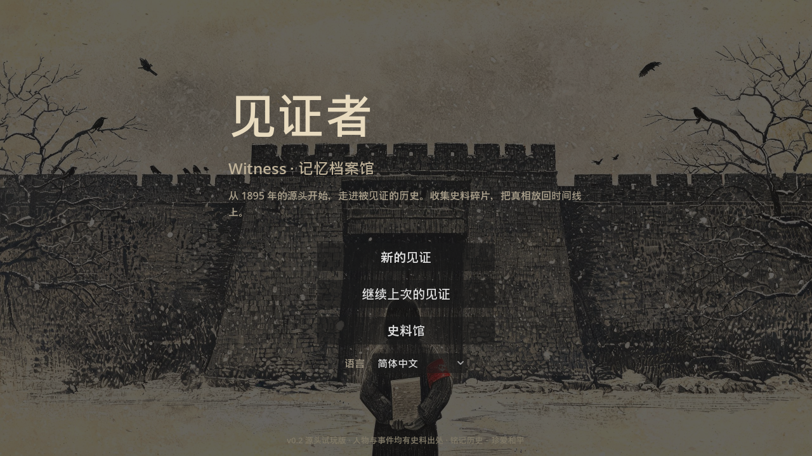

**记忆档案馆 · 时间线大地图（Talos Principle 式 Hub）**

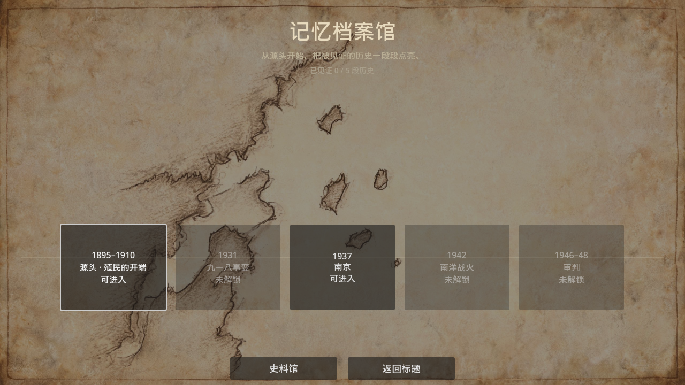

**试玩关「源头」· 彩色档案馆工作间（桌上/桌下/层板都可翻越到达）**

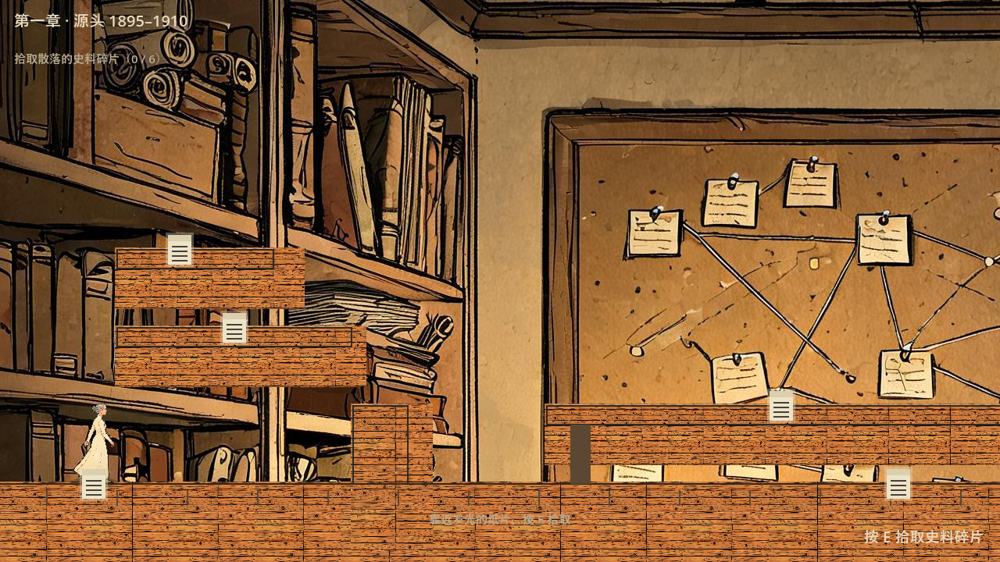

**时间线板 · 把碎片放回正确年代（Patrick's Parabox 式归位）**

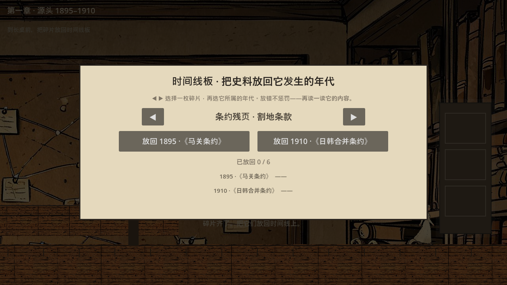

**放对之后 · 炭笔历史场景渐显（Viewfinder 时刻）**

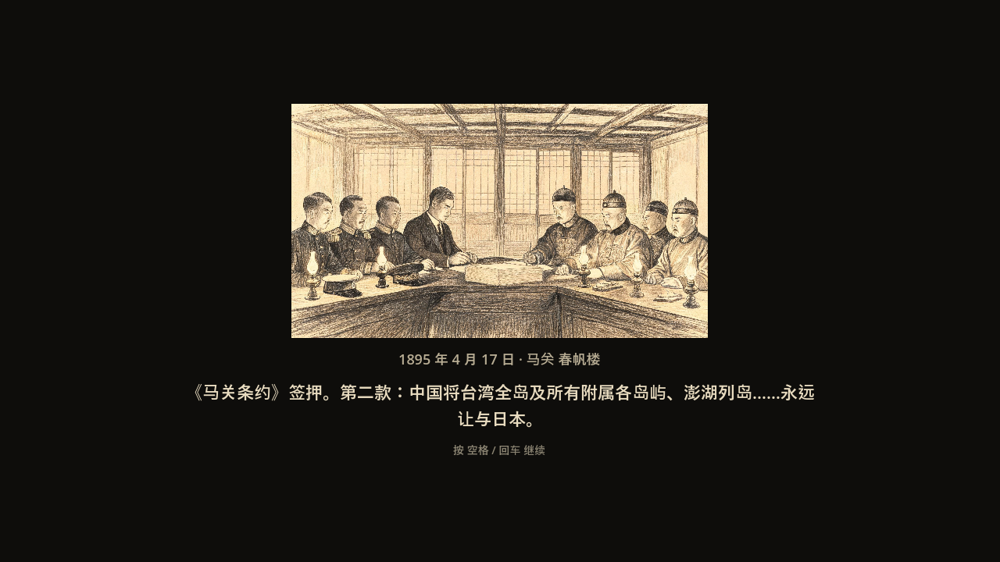

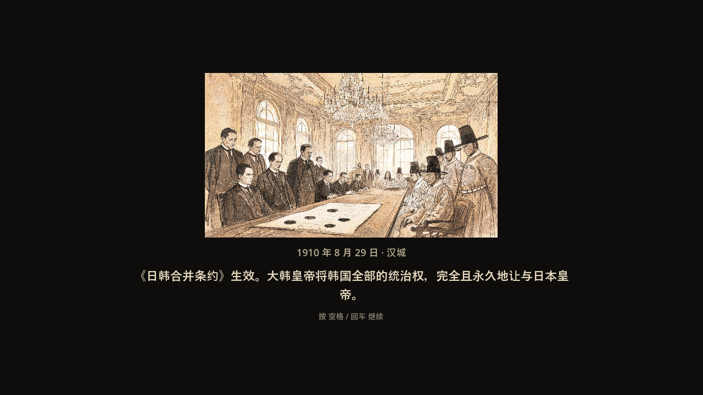

**史料馆 · 通关解锁的档案卡**

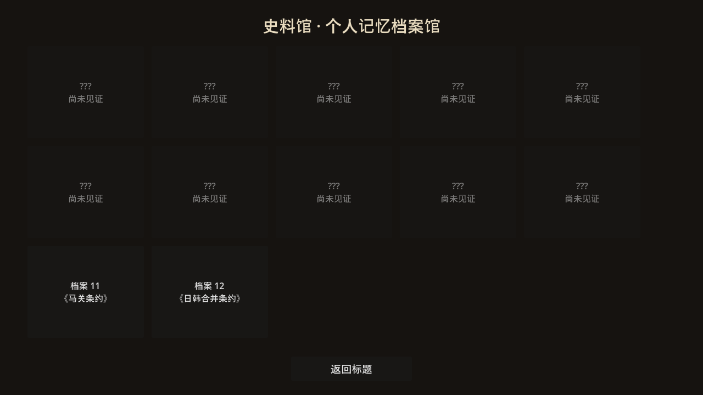

**关卡 01 · 南京 1937 · 彩色手绘街景（视差背景 + 平台地形 + 一家人跟随）**

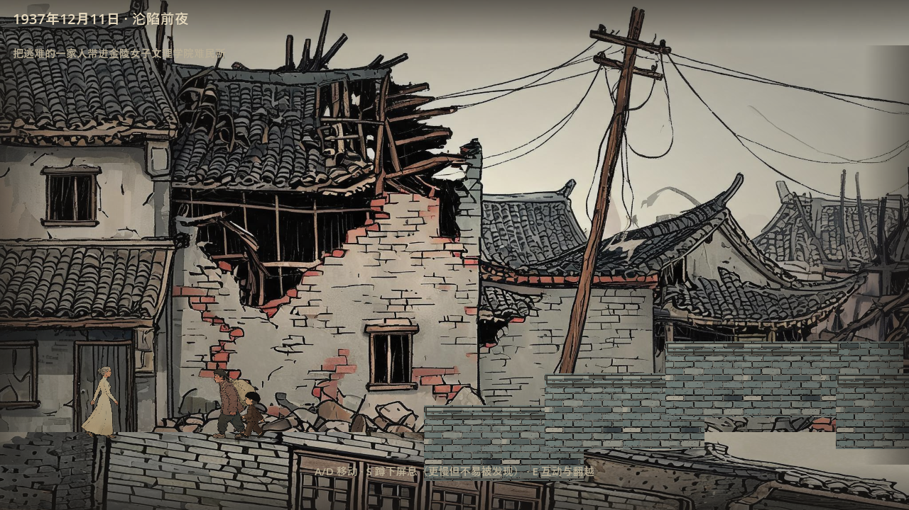

**E 键互动翻越（v0.4 替代跳跃的核心位移动词）**

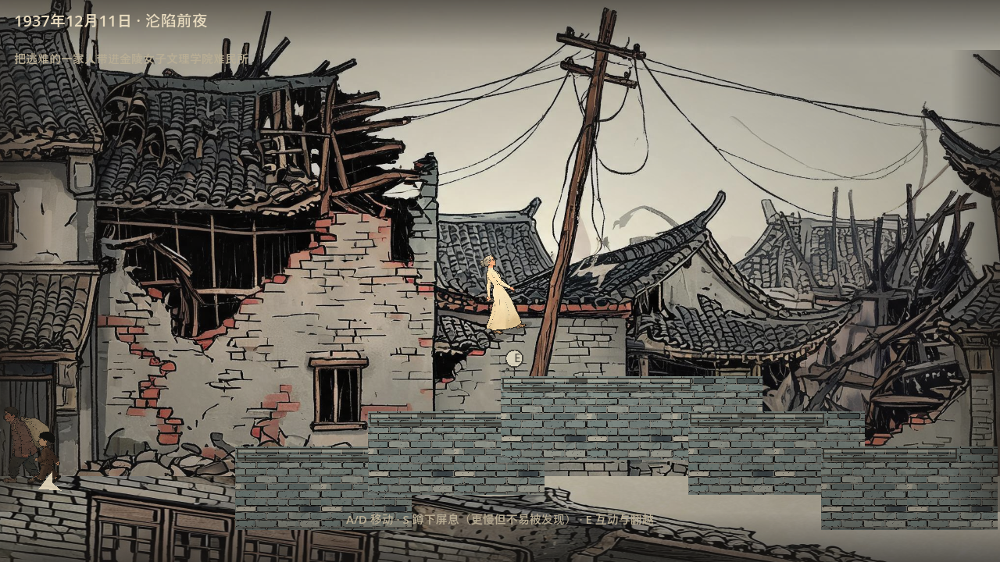

**金陵女子文理学院 · 绿琉璃瓦立面与月亮门**

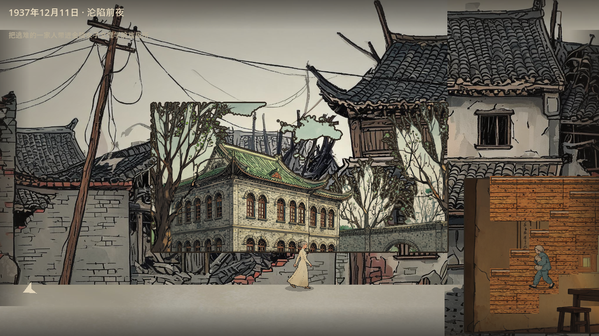

**环境解谜 · 木箱 / 门闩 / 巡逻兵（右下角为门闩提示）**

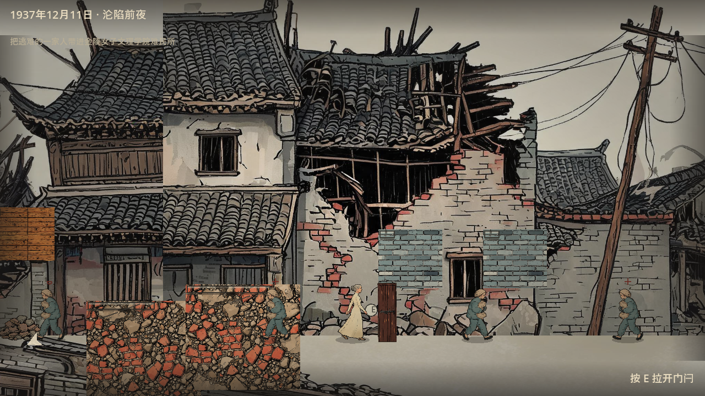

## 内容警告

本游戏取材于 1937 年南京的真实历史，包含战争、屠杀与性暴力的**记述与暗示**（均来自公开史料，不含血腥画面）。若你正处于创伤恢复期，请谨慎游玩。

## 如何运行（小白版，3 步）

1. **装 .NET 8 SDK**（编译 C# 必需）
   到 https://dotnet.microsoft.com/download/dotnet/8.0 下载并安装 .NET 8.0 SDK。

2. **装「.NET 版」Godot 4.7**（注意：不是普通版！）
   到 https://github.com/godotengine/godot-builds/releases 下载 **Godot_v4.7-stable_mono_win64.exe**（文件名带 `mono` 才是 .NET 版）。

3. **打开游戏**
   双击 Godot exe → 点「导入」→ 选择本项目的 `project.godot` → 打开 → 按 **F5** 运行。

> 也可以先在命令行运行 `dotnet build witness.sln` 确认编译通过（0 错误）再进 Godot。

## 玩法

### v0.2 试玩路线（约 8 分钟）

1. 内容警告 → 标题（居中）→「新的见证」进入**记忆档案馆**
2. 大地图时间线上选择 **1895–1910 源头**（恒解锁；1937 南京亦开放重访，其余章节待后续版本）
3. 试玩关：跟随教学（A/D 移动 · E 翻越）拾取 6 枚史料碎片（3 枚属 1895《马关条约》、3 枚属 1910《日韩合并条约》，桌上/桌下/书架层板需翻越到达）→ 走到右墙时间线板前按 E 打开 → 把碎片放回正确年代 → 炭笔历史场景显现 → 尾声指向 1931 / 1937

### 关卡 01：南京 1937（18–28 分钟一周目）

- **移动**：A/D 或 ←/→ 左右推进；**E** 互动与翻越（台阶、箱堆、断墙，高差 18~140px 均可攀上）；**S / ↓** 蹲下屏息（更慢但不易被巡逻发现）
- **环境解谜**：推木箱垫脚登高台 · 扔石块引开巡逻 · 拉门闩开侧巷 · 转阀门放蒸汽遮挡视野——全部用 E 键，靠近时出现情境提示
- **记录**：靠近发光的纸页，**按住 E 约 1.2 秒**（进度环）——巡逻看见时会被打断，留下残缺一页；记录时被发现，证据会被没收销毁
- **交谈/帮助**：按 E 与难民交谈，分配食物/药品/毯子（物资刻意不够分，分配确认后不可反悔）
- **没有 Game Over**：连续 2 次被发现会被押送至集合点，跳过剩余证据点——你改变不了发生的事，只能决定自己看见多少
- **Beat 3「记忆的重量」**：你的包袱只装得下 **3 件**证据。确认之后，不可反悔。
- 通关后进**史料馆**，逐张查看你解锁的史料卡（每张都有出处）

## 支持语言（9 种）

简体中文（默认）、繁體中文、English、日本語、한국어、Deutsch、Français、Русский、Bahasa Melayu

标题界面「语言」下拉即时切换；缺词条自动回退简体中文；语言偏好保存在本地。

## 史料出处（游戏内容的边界）

所有事件、数字、人物均来自公开史料：

- 《马关条约》（1895）与《日韩合并条约》（1910）条约文本（v0.2「源头」章依据）
- 《拉贝日记》（1997 年出版）
- 《魏特琳日记》（2000 年出版）
- 约翰·马吉牧师 16mm 实拍影像（后成为东京审判证据）
- 远东国际军事法庭（IMTFE）判决书（1948）
- 南京审判战犯军事法庭判决（1946–1947）
- 《东京日日新闻》1937 年「百人斩」连续报道

具名真实人物（魏特琳、费奇、拉贝、马吉等）首次出场时，屏幕下方会标注「真实历史人物 · 详见史料卡 X」。在世受害者一律不使用真名。

## 目录结构

```
witness/
├── project.godot        # 工程配置（含 [dotnet] assembly_name="witness"）
├── witness.sln/.csproj  # .NET 8 解决方案
├── scenes/Main.tscn     # 唯一场景（UI 全部由代码构建）
├── scripts/             # 全部 C# 脚本（标题/关卡/UI/角色）
│   └── core/            # 纯逻辑层：WitnessState 状态机、LocCore 本地化、PuzzleLogic 解谜规则
├── data/
│   ├── cards.json       # 12 张史料卡的配图映射
│   └── loc/*.json       # 9 种语言词条（zh-CN 为基准，244 键对齐）
├── assets/art/*.jpg     # VH 式彩色手绘漫画风美术（场景/角色）；史料卡面保留炭笔质感
└── tests/SmokeTest.cs   # headless 冒烟测试（91 项，含横版地形与解谜规则断言）
```

## 给开发者的提示（踩坑记录）

- **C# 脚本文件名必须与类名大小写完全一致**，否则 Godot 会静默跳过注册
- `project.godot` 必须显式写 `[dotnet] project/assembly_name="witness"`，否则报「DLL 找不到」
- headless 测试：`Godot_v4.7-stable_mono_win64.exe --headless --path . --script res://tests/SmokeTest.cs`（退出码 0 = 全部通过）
- 自动截图巡游：把 `scripts/ShotTour.cs` 临时挂到 project.godot 的 [autoload] 再正常运行游戏，跑完自动退出并输出到 `docs/screenshots/`

## 致谢与说明

- 美术：AI 生成插画（v0.4 起场景与角色为《勇敢的心》式彩色手绘漫画风，史料卡面保留炭笔/版画质感；v0.5 起角色/地形/物件全部换为手绘立绘与平铺纹理，运行时 ChromaKey 抠图管线处理）
- 字体：优先加载 `assets/fonts/` 下的字体；未内嵌时自动回退系统字体（Microsoft YaHei UI 等）
- 本项目为教育用途的非商业垂直切片；致敬所有在至暗时刻选择记录的人
